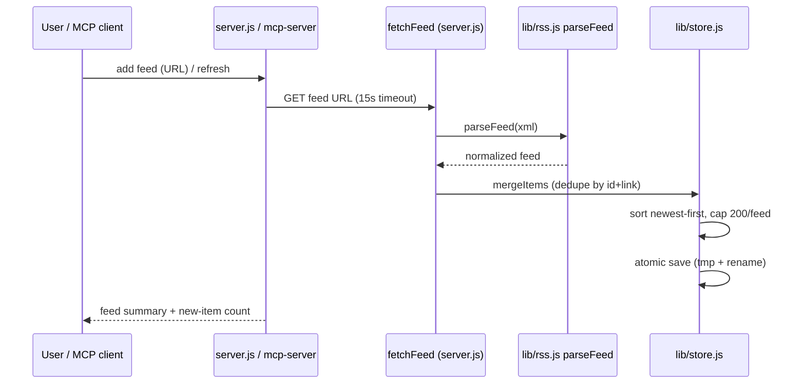

# Design — feed-engine spec

## Overview
The engine is two small modules with no framework dependencies:
`lib/rss.js` (pure parsing) and `lib/store.js` (persistence + merge).
`server.js` and `mcp-server/index.js` are thin callers; both share the store,
so the web UI and the MCP server always see the same state.

## Architecture



## Components

### lib/rss.js — `parseFeed(xml)`
- Built on `fast-xml-parser` (single dependency, battle-tested XML handling).
- Detects RSS 2.0 (`rss > channel`), Atom (`feed`), and RSS 1.0 (`rdf:RDF`).
- Normalizes to `{ title, link, description, items: [{ id, title, link, description, pubDate }] }`.
- `pubDate` is converted to ISO 8601 or `null`; descriptions are stripped of
  HTML tags and entities so the UI renders plain text.
- Throws `Error('Feed is not XML')` / `Error('Unrecognized feed format...')`
  on bad input — never returns partial data.

### lib/store.js — JSON store
- `load()` / `save(state)` around `data/feeds.json`; missing/corrupt file
  falls back to `data/seed.json` (Hacker News + NASA) and persists.
- `mergeItems(feed, parsedItems)`: dedupe by `id|link`, sort newest-first,
  cap 200 items/feed, returns the number of new items.
- `unreadCount(feed)`: counts items with `read === false`.
- `save()` writes `feeds.json.tmp` then renames — atomic on POSIX.

## Data model
```json
{ "feeds": [ {
    "id": "feed-1-abc123", "url": "https://…/rss",
    "title": "…", "link": "…", "description": "…",
    "lastFetched": "2026-11-09T12:00:00.000Z",
    "items": [ { "id": "…", "title": "…", "link": "…",
                 "description": "…", "pubDate": "…", "read": false } ]
} ] }
```

## Error handling
- Fetch errors (timeout, DNS, non-2xx) are surfaced per-feed in the refresh
  result (`{ id, ok: false, error }`); one bad feed never blocks the others.
- Invalid user input (bad URL, duplicate feed) returns 400/409 with a message.
- A corrupt store never crashes the server: it re-seeds and continues.

## Testing strategy
- `tests/rss.test.js`: parse the RSS 2.0 + Atom fixtures; assert titles,
  links, CDATA stripping, date normalization; assert rejection of non-XML.
- `tests/mcp.test.js`: `mergeItems` dedupe + newest-first ordering.
- Live smoke test: `POST /api/feeds` with a real feed URL, then
  `POST /api/refresh` — run manually against the dev server (network needed).
