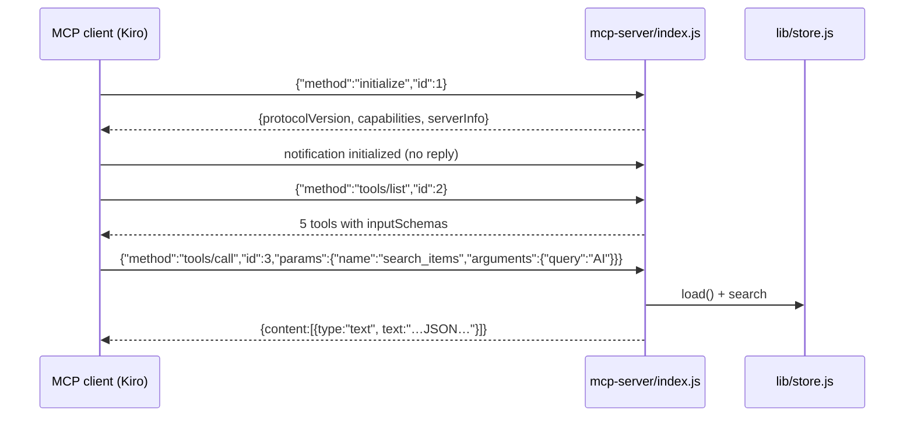

# Design — mcp-server spec

## Overview
A single file, `mcp-server/index.js`, implementing the MCP stdio transport by
hand: newline-delimited JSON-RPC 2.0 on stdin/stdout. No MCP SDK — the protocol
surface we need (initialize, ping, tools/list, tools/call) is small, and a
zero-dependency server is easier to audit and to run.

## Protocol flow



## Components

### Transport
- stdin is read as UTF-8, split on `\n`; each line is one JSON-RPC message.
- Replies are written as one JSON object per line on stdout. Nothing else
  ever writes to stdout (no `console.log` in this file).
- Notifications (`id` absent) never get a reply. Malformed lines are skipped.

### Tool dispatch (`callTool`)
- Each tool is a case in a `switch` over the five names; unknown names return
  an `isError: true` result instead of crashing.
- `add_feed` reuses the same fetch logic as the HTTP server (same User-Agent,
  15 s timeout) and the same `parseFeed` + `mergeItems` path — one code path
  for both surfaces, so behavior cannot drift.
- Results are returned as `content: [{ type: "text", text: <JSON string> }]`
  so any MCP client can display them without special handling.

### Kiro wiring
- `.kiro/settings/mcp.json`:
  ```json
  { "mcpServers": { "revenant": {
      "command": "node",
      "args": ["mcp-server/index.js"],
      "disabled": false } } }
  ```
  (stdio servers run with the workspace root as cwd, so the relative path resolves.)
- `.kiro/agents/revenant-librarian.json`: a custom "librarian" agent with the
  `revenant` MCP server and `resources: ["file://.kiro/steering/**/*.md"]`
  so it answers with project context.

## Testing strategy
- `tests/mcp.test.js` spawns the real server over stdio and drives it:
  initialize → tools/list (exact 5 names) → unread_count / list_feeds shape.
- Manual: `echo '{"jsonrpc":"2.0","id":1,"method":"tools/list"}' | node mcp-server/index.js`
  (after an initialize) — or connect it in Kiro once logged in.
